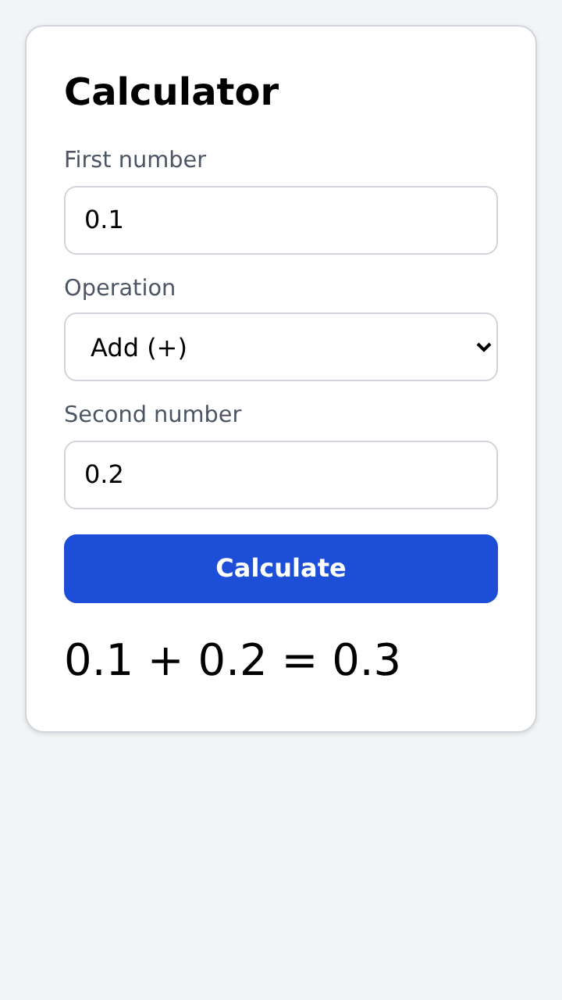

# Calculator

Full-stack calculator: a Go JSON API and a React + TypeScript frontend. It supports addition, subtraction, multiplication and division, plus the optional exponentiation, square root and percentage.



## Quick start (Docker)

```sh
make docker-run     # or: docker build -t calculator . && docker run --rm -p 8080:8080 calculator
```

Open http://localhost:8080. One container serves both the UI and the API.

## Local development

Requirements: Go 1.27+, Node.js 24+ and `make` (each target is a one-line command if you prefer to run it by hand; see the [Makefile](Makefile)).

```sh
cd frontend && npm install && cd ..

make run-backend    # API on http://localhost:8080 (override with PORT)
make run-frontend   # UI on http://localhost:5173, proxies /api to the backend
```

## Tests and coverage

```sh
make test       # backend: go vet + go test -race; frontend: vitest
make lint       # gofmt, go vet, staticcheck, oxlint, tsc
make coverage   # regenerates the reports in coverage/
```

| Layer | Coverage | Report |
| --- | --- | --- |
| Backend (`internal/...`) | 94.4 % of statements | [coverage/backend.txt](coverage/backend.txt), `coverage/backend.html` |
| Frontend | 98.4 % of lines, 95.9 % of branches | [coverage/frontend/coverage.txt](coverage/frontend/coverage.txt), `coverage/frontend/index.html` |

The reports are committed so they can be read without running anything. What is not covered is defensive: an unmapped domain error, a failure while writing a response, and the fallback for a non-API error in the UI. `cmd/server` only wires configuration and graceful shutdown and is checked by running the server and the container.

Backend tests are table-driven: the domain package is tested on its own, and the handlers through `httptest`. Frontend tests use Vitest and Testing Library, query by accessible role and label, and mock `fetch`.

## API

### `POST /api/v1/calculate`

Request: `{"operation": string, "a": number, "b": number}`. `b` is omitted for `sqrt`. Response: `{"result": number}`.

| Operation | Operands | Example | Result |
| --- | --- | --- | --- |
| `add` | `a`, `b` | `{"operation":"add","a":2,"b":3}` | `5` |
| `subtract` | `a`, `b` | `{"operation":"subtract","a":2,"b":3}` | `-1` |
| `multiply` | `a`, `b` | `{"operation":"multiply","a":2,"b":3}` | `6` |
| `divide` | `a`, `b` | `{"operation":"divide","a":3,"b":2}` | `1.5` |
| `power` | `a`, `b` | `{"operation":"power","a":2,"b":10}` | `1024` |
| `sqrt` | `a` | `{"operation":"sqrt","a":2}` | `1.4142135623730951` |
| `percentage` | `a`, `b` | `{"operation":"percentage","a":20,"b":150}` | `30` (20 % of 150) |

```sh
curl -s -X POST localhost:8080/api/v1/calculate \
  -H 'Content-Type: application/json' \
  -d '{"operation":"percentage","a":20,"b":150}'
# 200 {"result":30}

curl -s -X POST localhost:8080/api/v1/calculate \
  -H 'Content-Type: application/json' \
  -d '{"operation":"divide","a":1,"b":0}'
# 422 {"error":{"code":"DIVISION_BY_ZERO","message":"division by zero"}}

curl -s -X POST localhost:8080/api/v1/calculate \
  -H 'Content-Type: application/json' \
  -d '{"operation":"sqrt","a":9,"b":2}'
# 400 {"error":{"code":"INVALID_OPERAND_COUNT","message":"invalid operand count: \"sqrt\" takes 1 operand(s), got 2"}}
```

### Errors

Every error has the same shape: `{"error": {"code": "...", "message": "..."}}`. Clients should branch on `code`; `message` is for humans.

| Status | Code | When |
| --- | --- | --- |
| 400 | `INVALID_JSON` | Malformed body, trailing data, unknown fields, wrong types, numbers outside the float64 range, body over 1 KiB |
| 400 | `MISSING_OPERAND` | `a` is missing (an explicit `0` is valid) |
| 400 | `INVALID_OPERAND_COUNT` | `b` missing for a binary operation, or present for `sqrt` |
| 400 | `UNKNOWN_OPERATION` | Operation missing or not supported |
| 422 | `DIVISION_BY_ZERO` | `divide` with `b = 0` |
| 422 | `NEGATIVE_SQUARE_ROOT` | `sqrt` with `a < 0` |
| 422 | `NON_FINITE_RESULT` | Overflow, or an undefined result such as `0 ^ -1` or `(-8) ^ 0.5` |
| 404 | `NOT_FOUND` | Unknown route under `/api/` |
| 405 | `METHOD_NOT_ALLOWED` | Method other than POST on `/api/v1/calculate` (with an `Allow: POST` header) |

### `GET /healthz`

Returns `200 {"status":"ok"}`, for container orchestrators and load balancers.

## Design decisions

- **One endpoint and a registry of operations.** Each operation is an entry in a map with its operand count, so validation lives in one place and adding an operation is one line plus tests. A route per operation (`POST /api/v1/divide`) would also have been reasonable; I chose a single endpoint because the operations share the same request and response shape.
- **Domain separated from transport.** `internal/calculator` knows nothing about HTTP, so the arithmetic and its edge cases are tested in isolation, and `internal/httpapi` only decodes, maps errors and encodes.
- **400 versus 422.** 400 when the request itself is wrong (shape, types, operand count); 422 when it is well formed but the result is undefined. Error codes are stable identifiers, mapped from domain errors in one table.
- **One check for non-finite results.** Rather than anticipating every case that overflows or is undefined, the domain rejects any `Inf` or `NaN` result. It also normalizes `-0` to `0`, which JSON would otherwise show as `-0`.
- **Strict input.** Pointer fields tell a missing operand from `0`; unknown fields, trailing data and bodies over 1 KiB are rejected. The server has read, write and idle timeouts and shuts down gracefully on SIGTERM.
- **Go standard library only.** `net/http` method routing, `encoding/json` and `log/slog` (one structured log line per request) are enough; `go.mod` has no dependencies.
- **The backend is the source of truth.** The frontend validates for fast feedback, but always relies on the API for the result and its errors. Known error codes are shown as user-facing messages; unknown ones fall back to the API message.
- **Frontend split by role.** `useCalculator` holds the form state and the API call, so the components only render. The API client (`services/`) and input validation and formatting (`utils/`) are plain modules with their own tests; the hook and components are tested together through the UI, the way a user drives them. Folders by role (`components/`, `hooks/`, `services/`) are a layout most React developers recognize; for one screen, feature folders would add nothing.
- **A form, not a keypad.** Two numbers and an operation map directly to the API, are accessible (labels, `aria-invalid`, `aria-describedby`, a live region for the result) and easy to use on a phone. A keypad would need an expression parser, which is out of scope.
- **One container, same origin.** The Go server serves the built frontend from `STATIC_DIR`, so there is no CORS to configure. In development the Vite proxy gives the same setup. The image is a distroless, non-root, ~17 MB image.

## Assumptions

- One operation per request; no expressions or chaining.
- `percentage` is "`a` percent of `b`": `percentage(20, 150) = 30`.
- `sqrt` takes only `a`; sending `b` is an error rather than being silently ignored.
- Numbers are IEEE 754 float64. The API returns the exact float64 value (`0.1 + 0.2 = 0.30000000000000004`); the UI rounds to 12 significant digits for display (`0.3`). Integers are exact up to 2^53.
- `0 ^ 0 = 1`, following IEEE 754 and Go's `math.Pow`.
- The UI accepts a dot as the decimal separator and scientific notation (`1e3`); commas, hex (`0x10`) and `Infinity` are rejected.
- The number fields use the default keyboard on phones, because the iOS decimal keypad has no minus sign.
- No authentication, persistence or rate limiting: this is a local tool, not a public service.

## Project layout

```
backend/
  cmd/server/            HTTP server: configuration, timeouts, graceful shutdown
  internal/calculator/   Domain: registry of operations and their edge cases
  internal/httpapi/      Handlers, request validation, error mapping, request logging
frontend/src/
  components/            Calculator (form, layout styles) and NumberField
  hooks/                 useCalculator: form state, validation, API call, error messages
  services/              calculatorApi: API client and error type
  constants/             Operations shown in the UI (mirrors the backend registry)
  types/                 Shared TypeScript types
  utils/                 Input validation and result formatting
coverage/                Committed coverage reports
Dockerfile               Multi-stage build: frontend, Go binary, distroless image
```

## With more time

- CI (GitHub Actions) running `make lint`, `make test` and the Docker build on every push.
- End-to-end tests with Playwright against the container.
- A `GET /api/v1/operations` endpoint so the frontend does not mirror the list of operations.
- An OpenAPI description of the API.
- If exposed publicly: rate limiting, metrics (request rate, latency, error codes) and tracing.
- Decimal arithmetic if exact results mattered, for example for money.

## AI usage

I used Claude Code throughout. The prompts, what each one produced, and my review notes are in [PROMPTS.md](PROMPTS.md).
